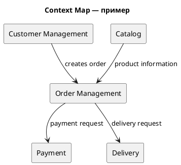

# Декомпозиция системы на микросервисы

Вариант 9993
10 млн
10 000 RPS

## 1. Предметная область

Железнодорожные билеты
Сервис покупки и возврата билетов на железнодорожные поезда.

## 2. Бизнес-возможности

- поиск поездов
- расписание
- выбор мест
- бронирование
- оплата
- возврат
- управление пассажирами
- уведомления

## 3. Основные сущности

Passenger
Train
Route
Station
Carriage
Seat
Ticket
Payment

## 4. Архитектурные ограничения

> Высокая доступность \
Критически важные операции системы должны быть доступны 24/7.

> Владение данными \
Каждая бизнес-область должна иметь явно определённого владельца своих данных.

> Независимое развертывание \
Отдельные части системы должны иметь возможность развертываться независимо.

- История операций должна храниться отдельно от транзакционных данных
- Отдельная команда отвечает за DevOps

## 5. Задание

Необходимо спроектировать декомпозицию исходного монолитного приложения на микросервисную архитектуру.

1. Определить основные bounded contexts.
2. Определить границы микросервисов.
3. Определить ответственность каждого сервиса.
4. Определить владельца данных каждого сервиса.
5. Определить основные взаимодействия между сервисами.
6. Обосновать выбранную декомпозицию.
7. Привести минимум две альтернативы.
8. Указать потенциальные проблемы архитектуры.

## 6. Что необходимо сдать

### Context Map

Постройте Context Map предметной области в PlantUML.

На диаграмме необходимо показать:
- основные bounded contexts;
- отношения между bounded contexts;
- направление взаимодействия;
- назначение основных взаимодействий.

### Каталог микросервисов

Пример описания одного сервиса:
Service: Order Service

Responsibility:
Создание и управление заказами пользователей.

Owned Data:
Order
OrderItem

API:
POST /orders
GET /orders/{id}
POST /orders/{id}/cancel

Dependencies:
Catalog Service
Payment Service

Communication:
REST + Kafka

Scalability:
Горизонтальное масштабирование.

### ADR-001. Архитектурное решение

Зафиксируйте одно из ключевых архитектурных решений, принятых при декомпозиции системы. ADR должен содержать:
- контекст проблем;
- рассмотренные альтернативы — минимум 2;
- выбранное решение;
- обоснование выбора;
- положительные и отрицательные последствия;
- итоговая архитектурная схема в C4.